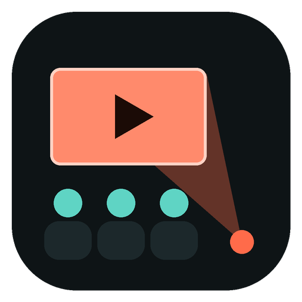

# Кинозал

Смотрим фильмы и показываем экран вместе — с камерами, чатом и общей паузой. Без серверов и регистрации: один создаёт зал, остальные заходят по пятизначному коду.



## Скачать

**[Скачать Kinozal-Setup.exe](../../releases/latest/download/Kinozal-Setup.exe)** — установщик для Windows. Ставится за пару секунд, без вопросов и без прав администратора; ярлык появится на рабочем столе и в «Пуске».

**Обновляется сам.** При запуске (и раз в 4 часа) Кинозал проверяет, не вышла ли новая версия, тихо скачивает её и предлагает перезапуститься. Не до того — обновится, когда закроешь программу.

> Windows может показать «Защитник Windows предотвратил запуск» — у программы нет платной цифровой подписи. Жми «Подробнее» → «Выполнить в любом случае». Это нужно только при первой установке.

## Что умеет

- **Залы по коду.** «Кинозал» или «Просто созвон» → отправь код → друг вводит его в «Меня позвали».
- **Только зал.** Кнопка «👥 Только зал» убирает экран и оставляет одни камеры — крупно, как в мессенджере, можно на весь экран. Своя камера — окошком в углу. Вернуться к кино — «🎬 Кинозал».
- **Видеосвязь и чат.** Камеры, микрофон, отдельная громкость голосов и фильма.
- **Громкость каждого.** Наведи мышь на камеру собеседника — регулятор от 0 до 200 %, только у тебя. Запоминается по имени.
- **Фото в чате.** 📎, Ctrl+V или перетащить картинку в чат. Большие фото ужимаются (до 1600 px), GIF уходят как есть. Клик — на весь экран и «Сохранить».
- **Фильм вместе.** Ведущий выбирает файл — у всех он идёт секунда в секунду. Пауза и перемотка общие: кто нажал, у всех сработало.
- **Свой файл — полное качество.** Если фильм скачан у обоих, второй жмёт «У меня есть этот файл»: каждый смотрит свой файл, а зал держит синхронизацию.
- **Трансляция фильма** до 20 Мбит/с со стерео-звуком, если файла у друга нет.
- **Субтитры** .srt / .vtt — у всех сразу, сдвиг ±0,5 с у каждого свой. Понимает и кодировку Windows-1251.
- **Показ экрана** до 1080p / 60 к/с (или родное разрешение) с системным звуком, лимит до 30–40 Мбит/с, кодирование на видеокарте (H.264). Показывающий видит превью и статистику: что захватывается, что реально уходит и что режет качество — интернет или процессор.
- **Камеры поверх экрана.** В полноэкранном режиме (и по кнопке 👥 в окне) камеры висят окошками поверх фильма: тащи мышью куда угодно, тяни за уголок — любой размер, двойной клик — на место. Чат всплывает поверх.
- **Без эха при показе экрана.** «Звук компьютера» уходит без голосов из Кинозала. На Windows 11 это делает сама Windows; на Windows 10 — встроенная эхо-защита: программа знает, что сыграла в динамики, и вычитает это из захвата (подавление ~30 дБ), не трогая звук игр и фильмов.
- **Подсказка про старую версию.** Если у собеседника Кинозал не обновился, в чате появится предупреждение.
- **Горячие клавиши:** Пробел — пауза, ← → — 10 секунд, F — весь экран, M — микрофон.
- **Подсказка с ffmpeg**, если файл без звука (AC3/DTS) или не открывается.

## Советы

- Сидите в **наушниках** — иначе звук фильма и экрана попадёт в микрофон.
- Качество показа экрана упирается в **скорость отдачи** у показывающего: для 1080p60 нужно от 10 Мбит/с.
- Если не получается соединиться — у кого-то строгий NAT; помогает другой интернет или VPN.

## Как это устроено

Electron-приложение, вся логика — в одном файле [`index.html`](index.html). Связь — WebRTC напрямую между участниками; для встречи по коду используется бесплатный сервер сигнализации [PeerJS](https://peerjs.com/) (через него идут только служебные сообщения, видео и звук — напрямую).

- [`main.js`](main.js) — окно, выбор экрана (`desktopCapturer`), системный звук, работа в фоне без притормаживания.
- [`preload.js`](preload.js) — мостик между окном и системой.
- [`index.html`](index.html) — интерфейс, залы, звонки, синхронизация, показ экрана. Открывается и просто в Chrome/Edge (без выбора окна и системного звука на некоторых системах).

## Сборка

```bash
npm install
npm start          # запустить из исходников
npm run dist       # собрать установщик dist/Kinozal-Setup.exe (без публикации)
```

Две копии на одном компьютере (для проверки): `Кинозал.exe --profile=2`.

## Выпуск обновления

Одна команда в PowerShell из папки проекта (нужен вход в GitHub CLI: `gh auth login`):

```powershell
.\release.ps1 1.2.0 "Что нового"
```

Скрипт поднимает версию, отправляет код, собирает установщик и выкладывает релиз — у всех, у кого Кинозал установлен, он обновится сам. Номер версии должен быть больше предыдущего.

## Лицензия

[MIT](LICENSE)
